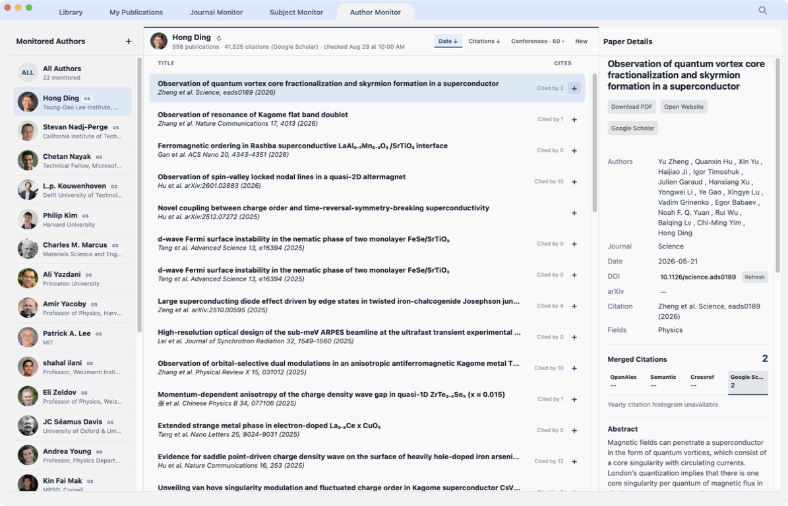
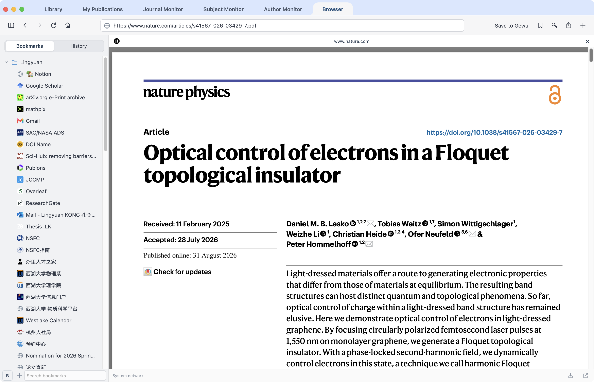

# Gewu Insight

**A research workspace that keeps papers, their versions, and research context
connected—from discovery to reuse.**

Gewu Insight brings continuous literature discovery, organization, and reading
into one workspace. Each paper retains a shared identity as metadata,
publication versions, supporting files, and research context accumulate,
building a lasting research record that researchers can inspect, revisit,
and reuse.

**Keep research objects visible, evidence traceable, and insight cumulative.**

[Website](http://gewu-insight.com) · [Quick start](#quick-start-on-macos) ·
[Explore the workspace](#explore-the-workspace) ·
[User Guide](paper_monitor/Gewu_Insight_User_Guide.pdf) ·
[AI & MCP](#work-with-an-ai-client) · [Citation](#citation) ·
[License](#copyright-and-license)

**Version 1.0.0 · Build 1** · Native macOS App · Source-available research software

Academic/non-commercial research use is permitted under the custom
[LICENSE](LICENSE). Commercial use requires separate prior written authorization.

  

  

<em>One paper, connected files: inspect its versions, choose a Default, and read its metadata alongside your Library.</em>

## Why Gewu Insight

- **Follow the literature.** Track journals, research topics, and authors through
  three complementary monitors. Save relevant papers into your own collections.
- **Organize around your research.** Use Library folders and project Spaces;
  the same paper can appear in several contexts with one shared identity.
- **Keep the evidence together.** Read PDFs and Markdown notes, compare versions,
  and retain supplements, annotations, data, and code in Paper Files.
- **Continue with context.** Revisit saved reading material, maintain your own
  publication record, and optionally let an authorized AI client read papers
  and append analyses with source references.

## Quick start on macOS

**Requirements:** macOS 14 or later, a working `python3` command, and network
access for the initial dependency installation and online research services.
The supplied native launcher supports Apple silicon and Intel Macs.

1. **Get the whole project.** Use this repository's **Code → Download ZIP** or
   clone it. Extract or keep the complete folder in a regular local location,
   such as `~/Applications/Gewu-Insight`.
2. **Open `Gewu Insight.app` inside that folder.** Keep it beside
   `paper_monitor`, `config`, and the other project files. The App is a launcher
   for this folder-based installation, not a standalone installer.
3. **Allow the first setup to finish.** The launcher prepares the local Python
   environment, installs dependencies, and starts the local service and App.
4. **Try one paper.** Drag a PDF into a Library folder, or visit an article in
   **Browser** and choose **Save to Gewu**. Inspect its **Paper Files** and
   **Paper Details**, then create a Space for the project you are working on.

Open **Help → User Guide** in the App for illustrated instructions. If startup
fails, see [installation and troubleshooting](DISTRIBUTION.md#recipient-requirements)
and `logs/paper_monitor_launcher.log`; do not delete the database to repair startup.
For a terminal-based setup, see [the development guide](docs/DEVELOPMENT.md#manual-setup).

## Explore the workspace

Six main tabs connect discovery, reading, organization, and your own publications.
Spaces and shortcuts are part of the Library workspace. These screenshots show
the real macOS App; select an image to inspect it at full size.

<table>
  <tr>
    <td width="50%" valign="top">
      
       <strong>Library &amp; Spaces</strong> 
      Organize papers and standalone files in folders and project Spaces.
      Browse List or Table View, search a collection, and sort by Time added.
      Shortcuts provide another route to existing folders.
    </td>
    <td width="50%" valign="top">
      
       <strong>My Publications</strong> 
      Maintain your publication list, authorship roles, ordering, and citation
      evidence. Export to Word, LaTeX, PDF, or an Overleaf project. Manual roles
      and ordering survive metric refreshes.
    </td>
  </tr>
  <tr>
    <td width="50%" valign="top">
      
       <strong>Journal Monitor</strong> 
      Follow selected journals and arXiv updates. Browse by date, venue, and
      field, inspect figures and abstracts, and save papers with their source
      information. Your subscription choices persist across updates.
    </td>
    <td width="50%" valign="top">
      
       <strong>Subject Monitor</strong> 
      Build reusable topics from search terms and review their dated results.
      Selecting a calendar date opens saved results; refreshing a topic is a
      separate action, with its status visible.
    </td>
  </tr>
  <tr>
    <td width="50%" valign="top">
      
       <strong>Author Monitor</strong> 
      Follow selected researchers through supported scholarly profiles, browse
      their publications, and identify new unread papers. Refreshes respect
      source limits and show cooldowns when a service restricts access.
    </td>
    <td width="50%" valign="top">
      
       <strong>Browser</strong> 
      Read publisher pages and PDFs in the built-in WebKit browser, with tabs,
      bookmarks, and local history. Save to Gewu lets you review the paper's
      identity, destination, and file type before importing it.
    </td>
  </tr>
</table>

For an existing collection, **Folder Loader** imports a directory tree. Portable
folder export includes files and a manifest for importing their relationships
into another Gewu workspace; see the [User Guide](paper_monitor/Gewu_Insight_User_Guide.pdf).

Browser tab controls, bookmark import and sync, downloads, and system Passwords
behavior are covered in the [User Guide](paper_monitor/Gewu_Insight_User_Guide.pdf)
and [Browser documentation](#documentation). Website links from the other
workspaces open in Browser; local PDFs open in macOS Preview.

## One paper, connected files and evidence

A paper's **Gewu Key** connects its identifiers, metadata, files, and placements
across the workspace. Adding that paper to another folder or Space reuses the
shared record. An ordinary standalone non-PDF file can also be stored in the
Library, without being assigned a public Gewu Key.

**Paper Files** keeps the Published version, accepted manuscript, preprints,
supplements, annotated copies, and other attachments associated with that paper.
You can inspect classifications and choose which file is **Default**. An explicit
Default is retained when other versions arrive; supplements do not automatically
replace the main article simply because they are PDFs.

Use in-app **Quick Look** to preview PDFs and Markdown notes, or open a local PDF
in **Preview**. Managed documents remain real files: the Default occupies the
main managed location, and other Paper Files belong in **Associated Files**.
Additional placements can use Finder aliases to the same originals. Move,
rename, and reassign managed files through the App so records and disk paths
stay coordinated. See [managed file layout](docs/MANAGED_FILE_LAYOUT.md).

## Work with an AI client

AI Access is **optional and off by default**. Gewu provides a local API and an
MCP adapter so an AI client can work with explicitly authorized collections.
Enabling access does not itself call a model, upload a library, or start an
analysis job.

A typical workflow is: select a paper → let the client read its authorized files
→ save a Markdown analysis with source file and page references → review the
note in Paper Files. A later authorized session can retrieve the saved paper
and analysis to continue the work.

In **Setting → AI Access**, create a named connection, choose its collection
and expiry, and grant the operations it needs:

- **Read:** metadata, directory browsing, and file contents have defined access
  boundaries; file reading and directory browsing are separately enabled.
- **Save analyses:** append Markdown notes with source references without
  overwriting existing Paper Files or earlier analyses.
- **Organize and import:** separately allow Space/folder creation, prepared
  paper or standalone-file imports, Paper Files attachment, moves, or renames
  within selected Library and Space roots. My Publications write access is
  not exposed.

Paper imports require metadata supplied by the AI client and reuse existing
DOI/arXiv identities. They do **not** automatically run Resolve; resolving an
existing paper is a separate permission and call. Connections can expire or be
revoked, and existing connections do not gain new write permissions on upgrade.

Your AI client may send authorized content to its chosen model provider. These
grants govern API/MCP access; they do not restrict a program's independent
operating-system access to local files. Review generated analyses against their
sources. See [AI Access setup, tools, and permissions](docs/AI_ACCESS.md).

## Local data and online services

**SQLite is the source of truth** for paper identities, relationships, file
records, and workspace state. PDFs and attachments remain on disk; reports and
exports do not replace the database. Back up the database **and all managed file
roots together**, or back up the complete project while the App and service are
stopped. See [backup and update instructions](docs/DEVELOPMENT.md#safe-updates-and-backups).

The workspace uses a local-first architecture, with online services supporting
discovery, metadata, citation counts, and publisher access. Availability can depend on a
service's limits, the network or VPN exit address, and institutional access.
Gewu uses pacing and cooldowns; it does not bypass paywalls or access controls.
Configure optional service keys in **Setting → Literature Data Source**.

## Platform support

- **macOS** — the current native desktop release, with Finder, Preview, Quick
  Look, Dock, and native drag-and-drop integration. This is the primary
  development and validation platform.
- **Windows** — developed separately on the experimental Windows branch.
  This macOS baseline and its screenshots do not establish Windows feature parity;
  consult that branch's own build instructions and limitations.

The Python, SQLite, and web-interface core is separated from native desktop
integration. See [release scope](docs/RELEASE_1.0.0.md) and
[distribution requirements](DISTRIBUTION.md).

## Documentation

| Start here | What it covers |
| --- | --- |
| [Illustrated User Guide](paper_monitor/Gewu_Insight_User_Guide.pdf) | Daily workflows, settings, shortcuts, backup, and troubleshooting; also available through Help → User Guide. |
| [AI Access & MCP](docs/AI_ACCESS.md) | Client setup, collection grants, reading, analysis saves, imports, moves, and renames. |
| [Browser: Save to Gewu](docs/BROWSER_CAPTURE.md) | Reviewing article identity, PDF candidates, file types, and import destinations. |
| [Browser: keyboard & bookmarks](docs/BROWSER_KEYBOARD_AND_BOOKMARK_SYNC.md) | Navigation, bookmark import/export, and explicit one-way sync. |
| [Browser: PDFs](docs/BROWSER_PDF_PREVIEW.md) · [Passwords](docs/BROWSER_PASSWORD_AUTOFILL.md) | PDF viewing and the boundaries of system password integration. |
| [Managed file layout](docs/MANAGED_FILE_LAYOUT.md) | Default files, Associated Files, aliases, and recovery boundaries. |
| [Installation & distribution](DISTRIBUTION.md) | Folder-based installation, startup diagnostics, and clean packages. |
| [Development guide](docs/DEVELOPMENT.md) | Manual setup, architecture, CLI commands, builds, updates, and verification. |
| [Licensing explained](docs/LICENSING.md) · [Contributing](CONTRIBUTING.md) | Research use and sharing, reserved commercial rights, and contribution terms. |

The [HTML manual](paper_monitor/user_guide.html) is the source for the bundled
PDF. [Guide coverage and screenshot provenance](docs/USER_GUIDE_AUDIT.md) are
recorded separately from the product overview.

## Citation

If you use Gewu Insight in your research, please cite the accompanying paper.
The manuscript is being prepared for arXiv; its identifier and link will be added
here after it is posted. Until then, the provisional reference is:

> Kong, L. & Wu, Z. A stateful research information infrastructure for scientific
> discovery. Manuscript in preparation (2026).

Citation metadata is also available in [CITATION.cff](CITATION.cff) for GitHub's
**Cite this repository** feature.

<!-- After arXiv posting, update this reference and CITATION.cff together with
     the confirmed author list, title, year, arXiv identifier and canonical URL. -->

## Name and Chinese origin

Gewu Insight is known in Chinese as **格物洞见**. The name draws on **格物致知**
and expresses a research outlook shaped by the practice of physics.

- **格物 · Gewu** — begin with concrete phenomena, experimental observations,
  and questions from nature; keep research in contact with the world it seeks
  to understand.
- **洞见 · Insight** — seek the patterns and mechanisms behind phenomena
  through physical pictures, intuition, imagination, and insightful guesses.
  Mathematics serves as a tool for developing and expressing that understanding.

The workspace supports this practice by keeping papers, versions, supporting
files, and notes connected, so researchers can revisit experimental results,
compare physical pictures, and pursue emerging ideas. Questions, interpretation,
and scientific judgment remain with the researcher. Read more in the
[User Guide's explanation of the name](paper_monitor/user_guide.html#visual-identity).

**Investigate nature through experimental phenomena; seek insight through
physical pictures and intuition.**

（从实验现象中格物，以物理图像和直觉求洞见。）

## Copyright and license

Designed and developed by **Lingyuan Kong** and **Zhengran Wu**. 
Developed with coding assistance from **OpenAI Codex**.

Copyright © 2026 Lingyuan Kong and Zhengran Wu. All rights reserved.

Gewu Insight is **source-available research software** under the custom
**Gewu Insight Academic and Non-Commercial Research License**, not an
open-source license. The [LICENSE](LICENSE) permits academic/non-commercial
research use, including downloading, installing, running, studying, and modifying
it. Original and modified versions, derivatives, and patches may be shared free
of charge for permitted research under the same terms, retaining notices and
identifying modifications. This includes public research forks and pull requests.

Commercial use, commercial redistribution, sublicensing, and integration into
commercial products or services require **separate prior written authorization**.
Contact [info@gewu-insight.com](mailto:info@gewu-insight.com).
Independent research outputs do not inherit the software license merely by using
Gewu. A pull request does not transfer its author's copyright or grant additional
commercial rights; see the [contribution policy](CONTRIBUTING.md).

Third-party components, scholarly content, and services retain their own terms.
See [third-party notices](THIRD_PARTY_NOTICES.md) and the
[dependency and asset audit](docs/DEPENDENCY_LICENSE_AUDIT.md), including
outstanding font and artwork permissions.
