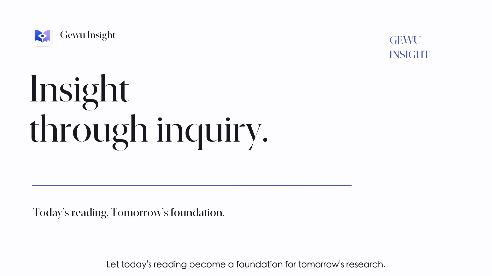
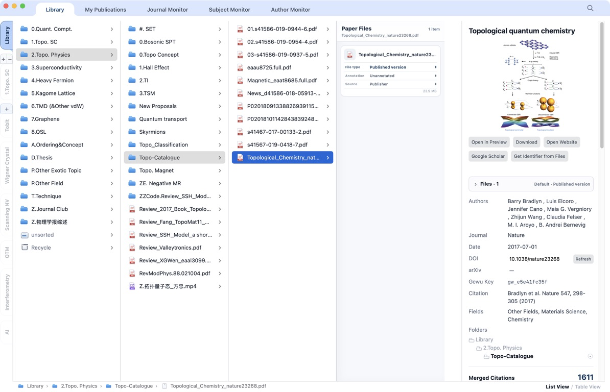
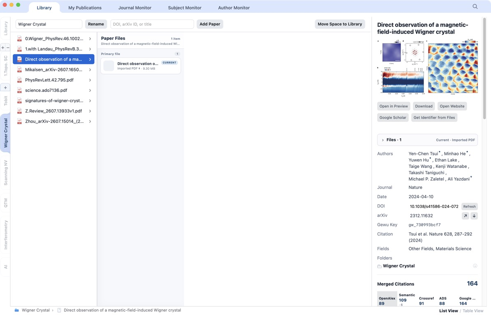
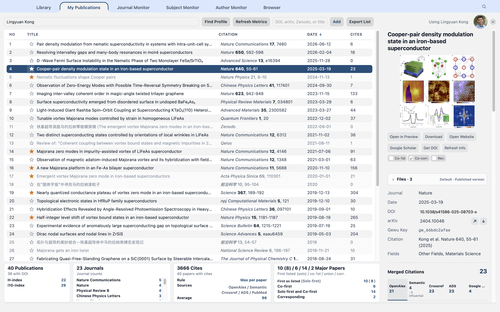
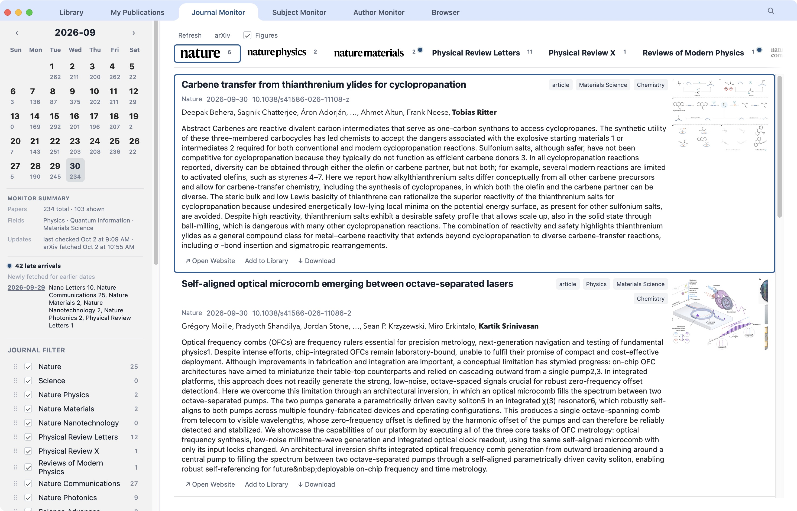
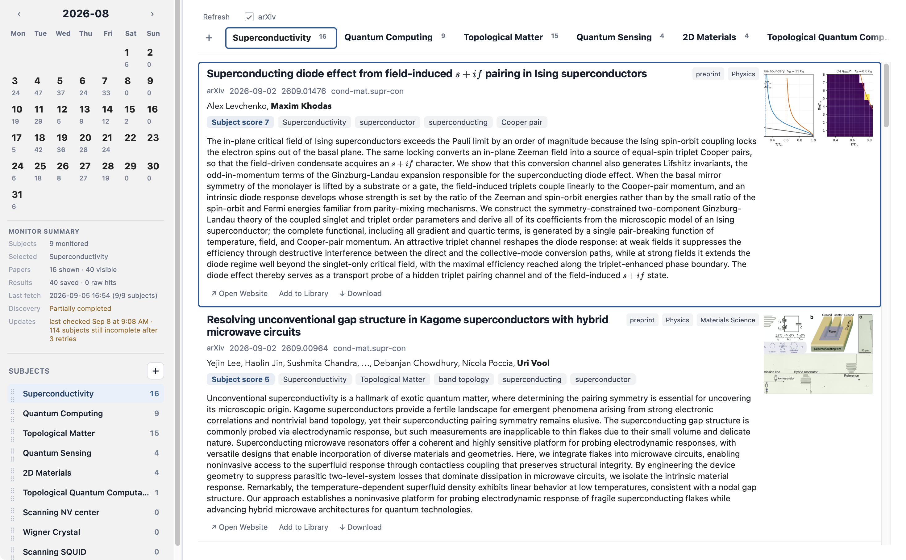
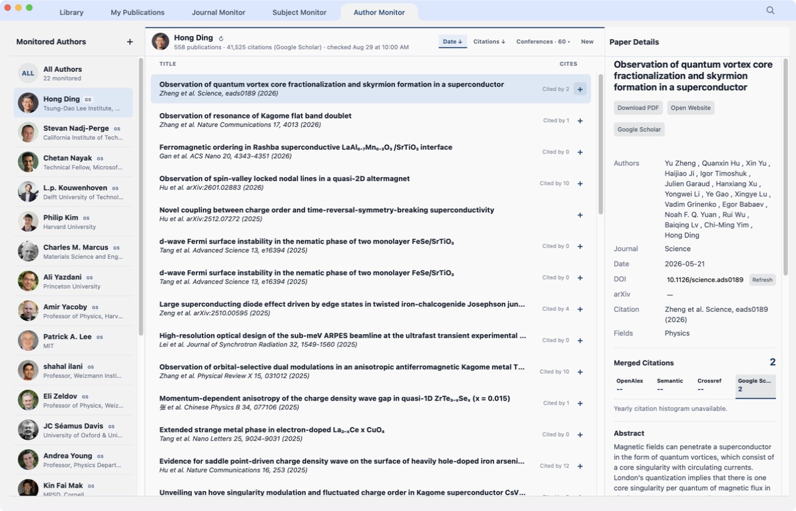
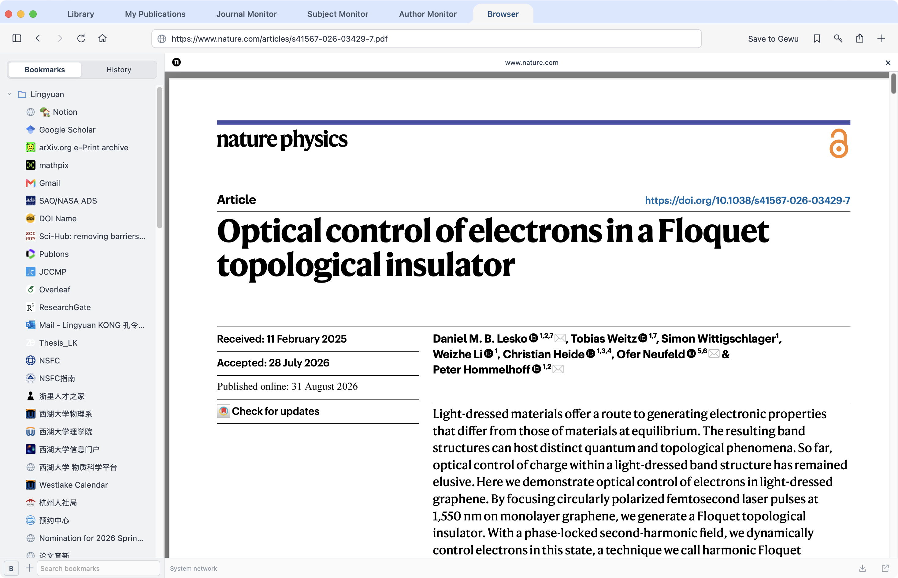

# Gewu Insight

**Follow new papers. Keep your PDFs and notes together. Pick up where your research left off.**

Gewu Insight is a desktop workspace for researchers who need to discover,
organize, and read scientific literature. Keep a paper's versions, supporting
files, and reading notes connected across projects. Optionally connect your AI
assistant so a later session can continue from the sources and analyses you saved.

**English** · [简体中文](docs/readme/README.zh-CN.md) · [繁體中文](docs/readme/README.zh-TW.md) · [日本語](docs/readme/README.ja.md) · [한국어](docs/readme/README.ko.md) · [Français](docs/readme/README.fr.md) · [Deutsch](docs/readme/README.de.md)

[**Download for macOS**](https://github.com/LKong92/Gewu-Insight/releases/tag/macos-1.1.0) ·
[**Download for Windows**](https://github.com/LKong92/Gewu-Insight/releases/tag/windows-1.1.0) ·
[**Watch the product film**](https://gewu-insight.com/product.html?lang=en#tour) ·
[Website](https://gewu-insight.com) · [User guides](https://gewu-insight.com/resources.html#resources)

**macOS 1.1.0 · Windows 1.1.0** · Local research library · Optional AI connection

## Watch Gewu Insight in action

<!-- Original video cover: https://gewu-insight.com/assets/product-poster-en.jpg -->
<p align="center">
  <a href="https://gewu-insight.com/product.html?lang=en#tour"></a>
</p>

**[▶ Watch in English · 5:19](https://gewu-insight.com/product.html?lang=en#tour)** ·
**[▶ 观看中文版 · 5:23](https://gewu-insight.com/product.html?lang=zh#tour)**

Click the cover to watch on the website. Follow discovery, the Library, reading,
My Publications, and AI collaboration, with chapters to jump between workflows.

[Try one paper](#try-one-paper-from-reading-to-reuse) · [Zotero](#work-with-zotero) ·
[AI & MCP](#work-with-an-ai-client) · [Platform support](#platform-support) ·
[Citation](#citation) · [License](#copyright-and-license)

These language links translate the project introduction, not the App interface.
The App and detailed manuals currently use English. Academic/non-commercial
research use is permitted under the custom [LICENSE](LICENSE); commercial use
requires written authorization. This is source-available software, not an
open-source license.

## Why Gewu Insight

| What you want to do | What Gewu keeps together |
| --- | --- |
| Keep up with your field | Journal, Subject, and Author Monitors, with saved results you can revisit. |
| Read a paper as it develops | Published versions, preprints, supplements, annotations, and notes in **Paper Files**. |
| Work across research projects | **Library** folders and **Spaces** that can refer to the same paper record. |
| Continue a reading session with AI | Authorized source files and saved analyses, available to a later connected session. |
| Manage your own research output | **My Publications**, authorship roles, citation evidence, and export tools. |

The [website's product tour](https://gewu-insight.com/product.html) shows all six
views. Its **5:19 product film** walks through discovery, reading, publication
management, and AI collaboration.

## Quick start

Download the installer under the release page's **Assets**, rather than GitHub's
**Source code** ZIP. Python and application dependencies are included.

| Platform | Requirements | Installer and release notes |
| --- | --- | --- |
| macOS | macOS 14+; Apple silicon or Intel | [macOS 1.1.0 DMG](https://github.com/LKong92/Gewu-Insight/releases/tag/macos-1.1.0) |
| Windows | Windows 10 version 1607+ (build 14393+) or Windows 11; Intel/AMD x64 | [Windows 1.1.0 Setup](https://github.com/LKong92/Gewu-Insight/releases/tag/windows-1.1.0) |

1. **Install.** On Mac, open the DMG and drag **Gewu Insight.app** to
   **Applications**. On Windows, run Setup and then open Gewu from the Start menu.
2. **Choose your data folder.** Create a **Gewu Database**, or open your existing
   one. Keep it separate from the program. Windows users retaining a collection
   should choose **Use existing Gewu Database**.
3. **Bring in one paper.** Drag a PDF into a Library folder, or visit its article
   page in **Browser** and choose **Save to Gewu**. Check its metadata and files.

Read the [installation notes](https://gewu-insight.com/download.html) for
first-launch guidance. Mac builds are not Apple-notarized; Windows installers
are unsigned. Setup may need internet access to install Microsoft WebView2.
Optional LibreOffice and TeX tools are installed separately.

**Already using Gewu?** Mac 1.0.x and Windows 1.0.0 users install 1.1.0 manually
once, retaining their existing database. After that, use **Gewu Insight → Check
for Updates** on Mac or **Help → Check for Updates** on Windows. Automatic daily
checks are optional; installation is your choice. Back up your data, close the
Gewu tab in Zotero, and finish or pause imports before installing.

## Try one paper: from reading to reuse

Start with a PDF you already have, or the [Gewu Insight paper](https://arxiv.org/abs/2610.14538).
For the latter, open its page in **Browser**, choose **Save to Gewu**, and review
the destination and metadata. If the PDF is unavailable through that action,
download it from the arXiv page and attach it to the same record in **Paper Files**.

1. **Collect:** keep the paper in a folder for a question you are working on.
2. **Read:** inspect **Paper Details** and preview the PDF in **Paper Files**.
3. **Connect, if you want AI:** configure **AI Access** for that collection with
   metadata, file-reading, saved-analysis-reading, and analysis-writing permissions.
   Follow the [client setup guide](docs/AI_ACCESS.md).
4. **Save what you learned:** give the connected client the paper's **Gewu Key**
   from Paper Details and explicitly ask it to save its analysis. For example:

   > Use the Gewu MCP tools to read paper YOUR_GEWU_KEY and its authorized PDF.
   > Summarize the question, evidence, and limitations, with page references.
   > Save the analysis to this paper through save_analysis, retaining the source
   > file ID and SHA-256. Do not overwrite existing files.

5. **Continue later:** start another connected session with access to the same
   collection and ask it to read the sources and saved analysis before proceeding:

   > For YOUR_GEWU_KEY, read the saved analysis and check it against the source
   > PDF. Which questions remain open, and what evidence would help resolve them?

Replace `YOUR_GEWU_KEY` with the actual key. Check the saved note in Paper Files.
This continuity comes from saved records; Gewu does not automatically archive
or synchronize your AI conversations. Discovery, organizing, and reading also
work without an AI account.

## Work with Zotero

- **Use Gewu inside Zotero:** install the bundled companion through
  **Plugin → Zotero Integration**. It opens the same Gewu installation and
  selected database in a Zotero tab, with the same papers and settings.
- **Choose where to save:** **Save to Gewu** keeps the paper in Gewu;
  **Save to Zotero** copies metadata and, optionally, the available Default PDF.
- **Bring your Zotero library over:** **Loader → Import from Zotero** lets you
  preview and copy collections, including their hierarchy and empty folders,
  into Gewu's file layout. The source Zotero library and originals remain intact.

These are explicit copies between libraries, not continuous two-way syncing.
See the [illustrated Zotero walkthrough](https://gewu-insight.com/zotero.html)
for installation, saving, and import steps.

## Explore the workspace

<details>
<summary><strong>See all six views — real macOS screenshots</strong></summary>

<p align="center">
  <a href="assets/user-guide/screenshots/library-paper-files.png"></a>
</p>

*One paper, its versions, and its research context together. Actual macOS App screenshot; click to enlarge.*

<table>
  <tr>
    <td width="50%" valign="top">
      <a href="assets/user-guide/screenshots/space-workspace.png"></a>
      <br><strong>Library &amp; Spaces</strong><br>
      Organize papers and standalone files in folders and project Spaces.
      Browse List or Table View, search a collection, and sort by Time added.
      Shortcuts provide another route to existing folders.
    </td>
    <td width="50%" valign="top">
      <a href="assets/user-guide/screenshots/my-publications.png"></a>
      <br><strong>My Publications</strong><br>
      Maintain your publication list, authorship roles, ordering, and citation
      evidence. Export to Word, LaTeX, PDF, or an Overleaf project. Manual roles
      and ordering survive metric refreshes.
    </td>
  </tr>
  <tr>
    <td width="50%" valign="top">
      <a href="assets/user-guide/screenshots/journal-monitor.png"></a>
      <br><strong>Journal Monitor</strong><br>
      Follow selected journals and arXiv updates. Browse by date, venue, and
      field, inspect figures and abstracts, and save papers with their source
      information. Your subscription choices persist across updates.
    </td>
    <td width="50%" valign="top">
      <a href="assets/user-guide/screenshots/subject-monitor.png"></a>
      <br><strong>Subject Monitor</strong><br>
      Build reusable topics from search terms and review their dated results.
      Selecting a calendar date opens saved results; refreshing a topic is a
      separate action, with its status visible.
    </td>
  </tr>
  <tr>
    <td width="50%" valign="top">
      <a href="assets/user-guide/screenshots/author-monitor.png"></a>
      <br><strong>Author Monitor</strong><br>
      Follow selected researchers through supported scholarly profiles, browse
      their publications, and identify new unread papers. Refreshes respect
      source limits and show cooldowns when a service restricts access.
    </td>
    <td width="50%" valign="top">
      <a href="assets/user-guide/screenshots/browser.png"></a>
      <br><strong>Browser</strong><br>
      Read publisher pages and PDFs in the built-in browser (WebKit on macOS),
      with tabs, bookmarks, and local history. Save to Gewu lets you review the paper's
      identity, destination, and file type before importing it.
    </td>
  </tr>
</table>

</details>

## One paper, connected files and evidence

A **Gewu Key** connects a paper's identifiers, metadata, files, and placements.
Adding it to another folder or Space reuses the shared record. **Paper Files**
keeps the **Published version**, preprints, and attachments together; you choose
the **Default** file.
Managed documents remain real files. Move and rename them through the App so
records and disk paths stay coordinated. See [managed file layout](docs/MANAGED_FILE_LAYOUT.md).

Supported correction and retraction notices remain linked to the original paper.
**Refresh Info** checks explicit Crossref relations; coverage depends on the
source, and saved papers are not continuously checked for notices.

## Work with an AI client

AI Access is **optional and off by default**. In **Setting** (Mac) or **Settings**
(Windows) **→ AI Access**, choose a collection, an expiry, and separate permissions
for reading, saving analyses, and organizing or importing. Connect a client
supporting local stdio MCP using the generated configuration.

Codex and DeepSeek Harness have been used with Gewu. Other compatible clients
require their own setup and verification. Enabling access does not itself call
a model or start an analysis. Saved analyses append Markdown notes rather than
overwriting source files; connections can be revoked.

Your AI client may send authorized content to its model provider. MCP grants
control the Gewu connection, not a program's independent operating-system file
access. Review analyses against their sources.
[Setup and permissions](docs/AI_ACCESS.md) · [Website walkthrough](https://gewu-insight.com/ai.html)

## Local data and online services

The App and your **Gewu Database** are separate. SQLite holds identities and
relationships; PDFs and attachments remain on disk. With the App and backend
stopped, back up the entire database folder, other managed roots, and externally
linked originals. Copying the App or source checkout is not a research backup.

Discovery, metadata refresh, publisher access, and online AI services require
network access and may depend on service limits or subscriptions. Gewu does not
bypass paywalls or access controls. See the [data and backup FAQ](https://gewu-insight.com/resources.html#data).

## Platform support

macOS remains the primary development and testing platform. Windows was ported
from it and is maintained on the separate **Windows** branch. Windows 11 has
received limited testing in a virtual machine; Windows 10 fixes have followed
external tester feedback, with limited direct testing by the development team.
The paper's evaluation was conducted on macOS. Screenshots here show macOS;
use your platform's manual for native controls and behavior.

## Documentation

| Start here | What it covers |
| --- | --- |
| [Website](https://gewu-insight.com) · [Product film](https://gewu-insight.com/product.html?lang=en#tour) | Product overview and real research workflows; English/Chinese website. |
| [macOS User Guide](paper_monitor/Gewu_Insight_User_Guide.pdf) · [Windows User Guide](https://github.com/LKong92/Gewu-Insight/blob/Windows/windows/Windows_Preview_Guide.pdf) | Illustrated platform manuals; also available in **Help → User Guide** and on the [website](https://gewu-insight.com/resources.html#resources). |
| [AI Access & MCP](docs/AI_ACCESS.md) | Client setup, collection grants, reading, saving analyses, and allowed writes. |
| [Zotero walkthrough](https://gewu-insight.com/zotero.html) · [Companion architecture](docs/ZOTERO_MONITOR.md) · [Import details](docs/ZOTERO_MIGRATION.md) | One Gewu workspace through two interfaces, plus explicit copies between libraries. |
| [Paper Files](paper_monitor/user_guide.html#paper-files) · [File layout](docs/MANAGED_FILE_LAYOUT.md) | Versions, Default files, attachments, and storage. |
| [Browser capture](docs/BROWSER_CAPTURE.md) · [Keyboard & bookmarks](docs/BROWSER_KEYBOARD_AND_BOOKMARK_SYNC.md) | Save articles and use the built-in browser. |
| [Mac updates](docs/MACOS_UPDATES.md) · [Windows distribution](https://github.com/LKong92/Gewu-Insight/blob/Windows/DISTRIBUTION.md) | Updates, installation, and platform requirements. |
| [Legacy migration](docs/SOURCE_DATA_MIGRATION.md) · [Development](docs/DEVELOPMENT.md) · [Distribution](DISTRIBUTION.md) | Source-based setup, migration, builds, and release procedures. |

Questions or a reproducible bug? [Open an issue](https://github.com/LKong92/Gewu-Insight/issues)
with your platform, App version, steps, and expected behavior. For installation
help, contact [info@gewu-insight.com](mailto:info@gewu-insight.com).

## Citation

If you use Gewu Insight in your research, please cite the accompanying paper.

> Kong, L. & Wu, Z. *A Stateful Research Information Infrastructure for Scientific
> Discovery.* arXiv:2610.14538 (2026). [Read the paper](https://arxiv.org/abs/2610.14538).

```bibtex
@misc{kong2026stateful,
  title         = {A Stateful Research Information Infrastructure for Scientific Discovery},
  author        = {Lingyuan Kong and Zhengran Wu},
  year          = {2026},
  eprint        = {2610.14538},
  archivePrefix = {arXiv},
  primaryClass  = {cs.DL},
  url           = {https://arxiv.org/abs/2610.14538}
}
```

Citation metadata is also available in [CITATION.cff](CITATION.cff) for GitHub's
**Cite this repository** feature.

The manuscript's evaluation uses the fixed software snapshot
[commit `539d00d`](https://github.com/LKong92/Gewu-Insight/tree/539d00dd1a3b0f5857912223868ca232d56680c9).
Use that snapshot when reproducing the reported results.

Evaluation data and reproducibility materials are available in the public
[Gewu Insight Evaluation repository](https://github.com/LKong92/Gewu-Insight-Evaluation),
maintained separately from the product source.

## Name and Chinese origin

Gewu Insight is known in Chinese as **格物洞见**. The name draws on **格物致知**
and expresses a research outlook shaped by the practice of physics.

- **格物 · Gewu** — begin with concrete phenomena, experimental observations,
  and questions from nature; keep research in contact with the world it seeks
  to understand.
- **洞见 · Insight** — seek the patterns and mechanisms behind phenomena
  through physical pictures, intuition, imagination, and insightful guesses.
  Mathematics serves as a tool for developing and expressing that understanding.

The workspace supports this practice by keeping papers, versions, supporting
files, and notes connected, so researchers can revisit experimental results,
compare physical pictures, and pursue emerging ideas. Questions, interpretation,
and scientific judgment remain with the researcher. Read more in the
[User Guide's explanation of the name](paper_monitor/user_guide.html#visual-identity).

**Investigate nature through experimental phenomena; seek insight through
physical pictures and intuition.**

（从实验现象中格物，以物理图像和直觉求洞见。）

## Copyright and license

Designed and developed by **Lingyuan Kong** and **Zhengran Wu**.<br>
Developed with coding assistance from **OpenAI Codex**.

Copyright © 2026 Lingyuan Kong and Zhengran Wu. All rights reserved.

Gewu Insight is **source-available research software** under the custom
**Gewu Insight Academic and Non-Commercial Research License**, not an
open-source license. The [LICENSE](LICENSE) permits academic/non-commercial
research use, including downloading, installing, running, studying, and modifying
it. Original and modified versions, derivatives, and patches may be shared free
of charge for permitted research under the same terms, retaining notices and
identifying modifications. This includes public research forks and pull requests.

Commercial use, commercial redistribution, sublicensing, and integration into
commercial products or services require **separate prior written authorization**.
Contact [info@gewu-insight.com](mailto:info@gewu-insight.com).
Independent research outputs do not inherit the software license merely by using
Gewu. A pull request does not transfer its author's copyright or grant additional
commercial rights; see the [contribution policy](CONTRIBUTING.md).

Third-party components, scholarly content, and services retain their own terms.
See [third-party notices](THIRD_PARTY_NOTICES.md) and the
[dependency and asset audit](docs/DEPENDENCY_LICENSE_AUDIT.md), including
outstanding font and artwork permissions.
