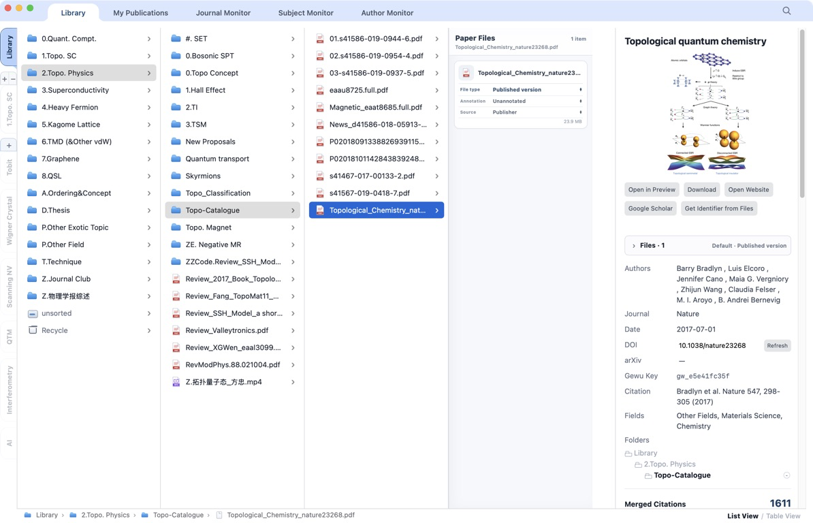
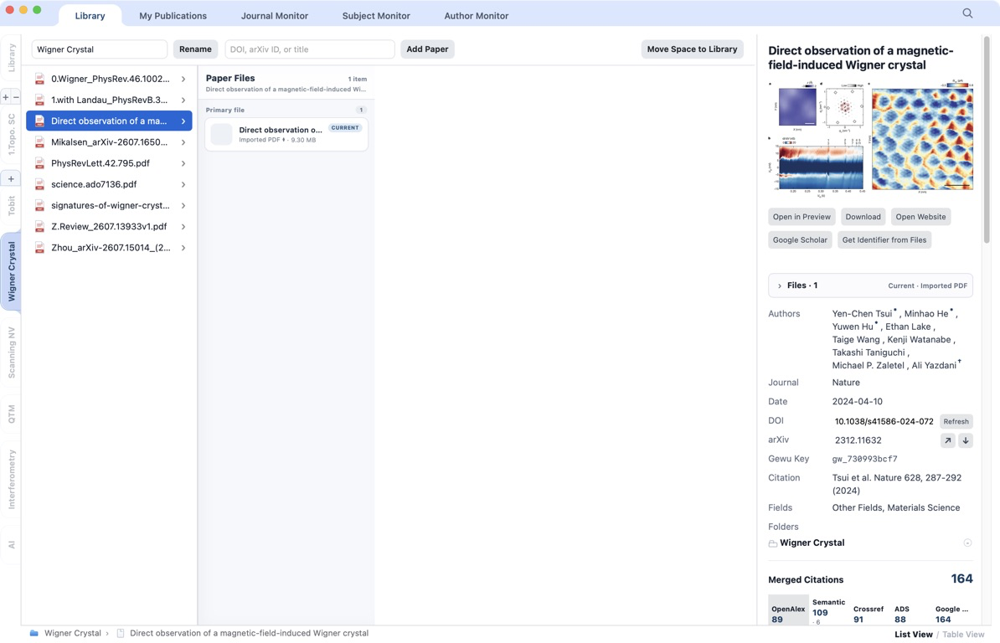
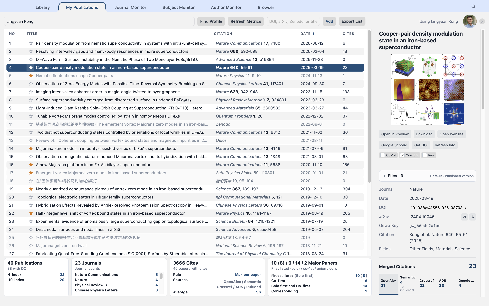
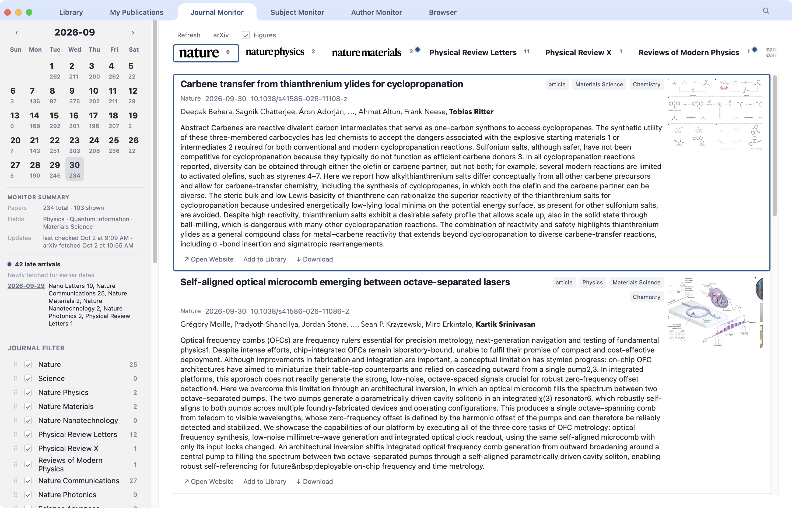
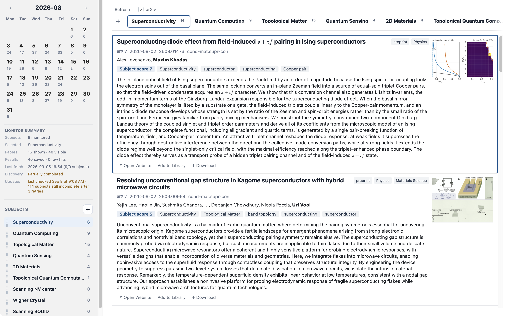

# Gewu Insight

**Version 1.0.0 · Build 1** — the macOS research and writing baseline.
The [User Guide](paper_monitor/Gewu_Insight_User_Guide.pdf) covers the current
workflows; [release notes](docs/RELEASE_1.0.0.md) describe versioning and scope.

**Keep research objects visible, evidence traceable, and insight cumulative.**

Gewu Insight is a local-first desktop workspace for discovering, organizing,
reading, and preserving scholarly work. It connects a research library,
versioned paper files, personal publications, and three complementary discovery
monitors around one persistent paper identity.

Gewu Insight is not only an RSS reader, a PDF folder, or unrelated pages.
It is a personal research information infrastructure in which discovery becomes
durable, file-backed, and auditable.

<p align="center">
  
</p>

## A workspace built around the research object

The interface keeps organization, evidence, and discovery close together. A
paper can move from a monitor into the Library, retain its source provenance,
gain identifiers and file versions, appear in a Space or My Publications, and
still resolve to the same persistent paper object.

<p align="center">
  
</p>

<p align="center"><em>The Library presents real folders and files while Paper Files keeps the current publication, earlier versions, and attachments connected.</em></p>

<table>
  <tr>
    <td width="50%" valign="top">
      
      <br><strong>Spaces</strong><br>
      Independent visible workspaces reuse the same paper identities and file
      relationships without duplicating the underlying research object.
    </td>
    <td width="50%" valign="top">
      
      <br><strong>My Publications</strong><br>
      Personal authorship roles, citation evidence, ordering, comments, and
      exports stay connected to the shared paper record.
    </td>
  </tr>
  <tr>
    <td width="50%" valign="top">
      
      <br><strong>Journal Monitor</strong><br>
      Browse venue and arXiv updates by date, source, field, and journal while
      preserving paper-level provenance.
    </td>
    <td width="50%" valign="top">
      
      <br><strong>Subject Monitor</strong><br>
      Follow reusable research topics with subject-specific calendar counts,
      explicit refresh state, and durable results.
    </td>
  </tr>
</table>

The sixth main tab, **Browser**, provides a visible native WebKit browser with
local Favorites-only Home, nested bookmarks, searchable local history, inline
PDFs, and session-aware downloads. Home uses the entire main area for the fixed
Favorites folder, without a Google webpage, separate search box or divider.
Enter search terms in the address field to search Google, or enter a URL directly.
Home is available offline, including after restarting the App; Reload on Home
refreshes local bookmarks. Site icons can need network and otherwise show initials.
Searches, webpages and sign-in still require a connection. Opening google.com
explicitly displays an ordinary webpage, with no Home-specific styling or zoom.
Nested Favorites use breadcrumbs; excess tiles use Previous/Next controls rather
than vertical scrolling. Sidebar and page status bars share the same bottom height.
A separate tab strip sits below the
address toolbar. Use the top-right **New Tab** (+ / ⌘T), a tab's × (⌘W), or
**Open Link in New Tab** in a webpage context menu. Command-click links also
opens a tab; bookmarks, Favorites and History have **Open in New Tab** actions.
Each tab retains its document, position and independent Back/Forward history;
switching tabs does not reload or stop another tab's load. Each tab lazily keeps
at most a Home and a browsing surface, with the same persistent Browser profile
for sign-ins. Tabs are memory-only, up to 32, and not restored after App quit.
Closing the final tab opens a fresh Home; bookmarks and saved history remain.
The sidebar can be resized or hidden, with a compact **B** menu, New Folder,
and Search at its bottom. B contains Import, Export, Sync from Safari, and
Sync from Chrome. Manual sync reads one explicitly chosen local bookmark file,
then one selected folder and its descendants. It adds entries and updates
source-owned unchanged items while preserving local edits and source deletions;
it never writes back or reads passwords, history, or cookies. If macOS denies
Safari file access, use an HTML export with Import. Browser arrows connect its
toolbar, webpage tabs, Favorites, and visible sidebar to the primary workspace
tabs; ordinary webpage arrows retain scrolling, with Up at the top returning
to chrome. Editing/custom controls retain their keys (⌘L then Escape returns
to the toolbar). Library's existing root-navigation exception is unchanged.
Bookmarks and
folders support Safari/Chrome HTML import/export (including a Safari ZIP with
one bookmark HTML file), and visible sites use a bounded local favicon cache.
The Passwords toolbar button opens macOS Passwords without creating a password
vault. A deliberate, unmodified click on a clearly marked HTTPS login username
or current-password field can invoke the system's native AutoFill > Passwords
menu action. Search, ordinary email, registration, verification-code and uncertain
fields are excluded. Each field kind is offered at most once per site per App
session, including cancellation; right-click AutoFill remains available manually.
This only triggers the system picker: site matching, authentication and actual
filling remain system/site-dependent, not Safari-equivalent guaranteed AutoFill.
No credential values, password lists or clipboard data are read. Viewable PDF attachments
stay inline; legacy HTTP GET redirects can retry once over HTTPS without
disabling certificate checks. Bookmarks and
history live in SQLite; cookies and cache use an independent persistent WebKit
profile. Browser follows the system network without changing proxy or Clash
rules. Website actions in Library, My Publications, Journal Monitor, Subject
Monitor, and Author Monitor switch to Browser and open a new webpage tab,
preserving existing pages. This includes publisher/Scholar/profile links,
preprints, citation sources, remote PDFs, Note links, and the Overleaf export
entry. The first link uses Browser's unused initial tab without loading Home
first. Local PDFs still open in Preview; file/folder actions stay native.
Browser's explicit Open in Safari remains a compatibility escape hatch.
The browser-hosted CLI UI opens an ordinary tab instead of invoking Safari on
the server. See the [website-entry audit](docs/WORKSPACE_BROWSER_LINKS.md).

The complete illustrated workflow—including Author Monitor, Browser, file versions,
portable export, backup, settings, and keyboard navigation—is available in the
[offline User Guide PDF](paper_monitor/Gewu_Insight_User_Guide.pdf).

## Platform support

Gewu Insight separates a portable Python, SQLite, and web-interface core from
platform-specific desktop integration.

- **macOS** — the current native desktop release. It is the primary development
  and validation platform and includes Finder, Preview, Quick Look, Dock, and
  native drag-and-drop integration.
- **Windows** — developed separately on the experimental Windows branch. This
  macOS baseline and its screenshots do not establish Windows feature parity;
  use that branch's own build instructions and limitations.

Instructions that name Finder, Preview, Quick Look, or the Dock describe the
current macOS integration rather than a limitation of the underlying research
data model.

## Core design commitments

- **Local ownership** — the live database and managed research files remain in
  the local project.
- **Visible evidence** — PDFs and attachments stay as real files that Finder,
  Preview, and other applications can inspect.
- **Continuity over time** — a preprint, later DOI, Published version,
  annotations, and personal contexts can accumulate around one paper object.
- **Explicit state and provenance** — complete, empty, partial, failed,
  downloaded, imported, and retried are distinct states.
- **Researcher control** — automation assists discovery and maintenance;
  scientific interpretation and organization remain with the researcher.

Local-first does not mean offline-only. Publisher pages, scholarly APIs,
profiles, and preprint services contribute evidence when network access is
available, but they do not become the owner of the workspace.

## System architecture

```text
External research sources
  journals · arXiv · metadata services · scholarly profiles
                         │
                         ▼
              Local application service
        identity resolution · scheduling · validation
                    │                 │
                    ▼                 ▼
            SQLite state core   Visible research files
        identity · relations     PDFs · versions · notes
        resources · provenance   supplements · data · code
                    │                 │
                    └────────┬────────┘
                             ▼
                Personal Research Workspace
        Library · Spaces · My Publications · Monitors
```

### SQLite is the source of truth

`data/paper_monitor.sqlite` is authoritative for paper identities, external
identifiers, relationships, folder placements, resource roles, source
provenance, preferences, and operational state. JSON, Markdown, HTML, Word,
LaTeX, and PDF outputs are exports or reading artifacts—not a second database.

The storage layer applies additive migrations when a newer app first opens an
older database. Existing paper identities, file paths, monitored-journal
choices, and provenance are preserved. Back up the database and managed files
together before a major update or migration.

### Persistent paper objects

A scholarly work is not reduced to one filename or one DOI. One stable Gewu Key
can connect:

- DOI, arXiv identifier, title, authors, venue, and dates;
- Journal, Subject, and Author Monitor provenance;
- Library folders, Spaces, and My Publications;
- Published version, accepted manuscript, preprint revisions, and imported PDFs;
- supplements, annotated copies, notes, presentations, data, code, and images;
- read state, download state, retries, failures, and timestamps.

Copying a paper to another folder creates another placement for the shared
paper; it does not manufacture another scholarly identity.

### Versioned, validated files

Paper Files groups the current publication PDF, other versions, supplements,
and attachments without pretending they are another Finder folder level.

- Automatic selection prefers publication-version PDFs; a user can explicitly
  set any existing non-invalid Paper File as Default. Manual selection is sticky.
- The Published version remains current when a preprint or accepted manuscript
  arrives later.
- Supplements and other attachments do not become the automatic Default merely
  because they use the PDF format. A PDF chosen as Default is promoted to the
  main file location, keeping the previous PDF in Associated Files.
- Exact SHA-256 detects byte-identical files; a content fingerprint can relate
  clean and annotated copies while preserving their differences.
- PDF validation rejects HTML responses, empty files, and truncated pseudo-PDFs
  before they become registered resources.
- Coordinated database and filesystem operations use rollback or compensating
  recovery instead of leaving half-completed moves.

## Name and Chinese origin

Gewu Insight is known in Chinese as **格物洞见**.

- **格物 · Gewu** — stay close to the research object: the paper, identifiers,
  versions, sources, files, and relationships remain inspectable.
- **洞见 · Insight** — let understanding grow through connected evidence,
  repeated reading, comparison, and the researcher's judgment.

The corresponding credo is: **让研究对象保持可见，让证据保持可追，让洞见能够积累。**

## Five connected work areas

### Library

The Library is a Finder-like reading and organization workspace with:

- multi-column folder navigation, keyboard control, drag and drop, copy/paste,
  rename, Recycle, and recoverable deletion;
- shortcut tabs and independent Spaces;
- List and Table views plus scoped search;
- Paper Details with DOI, arXiv, metadata, citations, figures, folders, and file
  actions;
- Paper Files navigation for current PDFs, earlier versions, supplements, and
  attachments;
- Quick Look inside the app and full opening in macOS Preview;
- portable folder export with a verified manifest for relationship-aware import.

Library, shortcuts, and Spaces share the same Paper Files keyboard path: select
a paper, press Right Arrow to enter its resources, navigate with Up/Down, and
press Left Arrow to return to the same paper.

### My Publications

My Publications reuses the shared paper and file model while adding personal
authorship context:

- profile discovery by name or exact Google Scholar URL;
- manual co-first, corresponding-author, and review/perspective roles;
- citation metrics from supported services;
- manual ordering, highlights, export inclusion, and citation-comment reports;
- LaTeX PDF, LaTeX source, Overleaf ZIP, and Word exports.

Manual authorship roles and ordering are preserved during metric refreshes.

### Journal Monitor

Journal Monitor records papers by venue and publication date. It supports:

- durable, SQLite-backed journal subscriptions;
- add, disable, restore, and drag-to-reorder behavior;
- per-source fetch progress and targeted journal retry;
- calendar, journal, preprint, and field filters;
- journal totals that remain independent of the active Field Filter;
- local caching of configured journal logos;
- inline mathematical typesetting in titles and abstracts;
- paper-level provenance linked to the canonical paper, fetch run, and source.

The journal list is personal database state. `config/journals.json` supplies
initial/default source definitions; replacing source code does not reset a
user's active list or re-enable a disabled journal.

### Subject Monitor

Subject Monitor discovers papers for reusable research topics using literal,
case-insensitive terms. Its candidate layer can draw from supported local feed
data and scholarly metadata services, then applies topic filtering and
deduplication before display.

Selecting a calendar date loads stored results; it does not silently start a
network request. Refreshing all subjects and retrying one subject are explicit
actions. Zenodo records are rejected during ingestion and cached-result display.

### Author Monitor

Author Monitor follows researchers through supported scholarly profiles:

- exact-profile selection and an initial read baseline;
- later unread/new-paper detection;
- resumable identifier and abstract enrichment;
- deliberately paced profile requests and visible cooldowns;
- locally cached profile photographs, with manual photo override;
- monitor deletion that removes the author relationship without deleting shared
  Library papers or PDFs.

## A continuous research loop

```text
Acquire → Identify → Resolve → Remember
   ↑                              │
   └──────── saved context ───────┘
```

1. **Acquire** through a monitor, Folder Loader, a DOI/arXiv identifier, or a
   local file.
2. **Identify** using external identifiers, title, authors, source evidence, and
   existing records.
3. **Resolve** metadata, resource roles, available versions, file paths,
   fingerprints, and the current PDF.
4. **Remember** provenance, placements, reading state, authorship, completion,
   failures, and personal organization.

## Quick start on macOS

The repository includes the native launcher:

```text
Gewu Insight.app
```

Double-click the app. On first launch, the launcher can prepare the local Python
environment, start the service at `127.0.0.1:8765`, wait for the first Library
view, and open the native application window.

Requirements:

- macOS 14 or later for the supplied universal native launcher;
- a working `python3` command;
- network access for dependency installation and online research services.

Keep the project outside protected or synchronized folders when possible. A
normal local development path is safer than Desktop, Documents, Downloads, or a
cloud-provider placeholder directory.

If startup fails, inspect:

```text
logs/paper_monitor_launcher.log
```

Do not delete SQLite as a startup repair.

## Manual setup and build

```bash
python3 -m venv .venv
. .venv/bin/activate
pip install -r requirements.txt
python3 -m paper_monitor ui --port 8765
```

Rebuild the native app after changing native UI, bundled assets, or app identity:

```bash
./scripts/build_macos_app.sh
```

Then open `http://127.0.0.1:8765/api/health` or launch the rebuilt app.

## Safe updates and migration

Before pulling a major update:

1. Quit Gewu Insight and make sure the local server has stopped.
2. Inspect `git status --short`; do not overwrite uncommitted product changes.
3. Back up the complete project, especially SQLite and every managed file root.
4. Pull or install the new version and rebuild `Gewu Insight.app`.
5. Start the app once so additive database migrations can run.
6. Verify a current PDF, an older version, an attachment, a Space, My
   Publications, and one monitor before deleting the backup.

Never migrate by copying only the database or only the visible Library folder.
Either choice leaves half of the managed workspace behind.

## Data layout

```text
data/paper_monitor.sqlite       authoritative SQLite database
data/Library/                   visible main Library and current files
data/Spaces/                    independent Space roots
data/My Publications/          managed files for personal publications
data/Associated Files/         versions, supplements, and attachments
data/cache/journal_logos/       rebuildable local logo cache
reports/                        generated notes and reports
logs/                           launcher and runtime diagnostics
config/journals.json            initial/default journal source definitions
```

Move and classify managed files through Gewu Insight. Manual Finder changes can
leave the saved resource path and the physical location inconsistent.

## Network services and credentials

Gewu Insight can use OpenAlex, Crossref, Semantic Scholar, NASA ADS, PubMed,
arXiv, scholarly profiles, feeds, and publisher pages where supported.

- Publisher and API availability can vary by network, VPN exit address, rate
  limit, institution, and access policy.
- The app uses pacing, cooldowns, and bounded retries; it does not bypass
  paywalls, CAPTCHA, browser verification, or access controls.
- OpenAlex, Semantic Scholar, and NASA ADS credentials can be managed in
  Open Source Settings.
- arXiv discovery coverage is managed separately in **Setting > arXiv Scope
  Settings**. One or more archive groups can be selected across primary
  subjects; the default is Physics > Condensed Matter.
- Credentials are local configuration. Do not write keys into source code,
  logs, tests, commits, screenshots, or issue reports.

Optional polite API identity values can be provided through the environment:

```bash
export OPENALEX_MAILTO=your.name@example.edu
export CROSSREF_MAILTO=your.name@example.edu
```

## User Guide

**Setting → AI Access** provides optional, revocable access for AI clients through
Gewu Keys. It is off by default. Create a connection with a paper collection and
permissions, then copy its MCP configuration into your AI client. Reading file
contents, browsing directories, adding analyses, creating Spaces/folders,
importing prepared files, moving or renaming folders/files, and standalone Resolve have separate permissions.
Imports require AI-supplied metadata, reuse DOI/arXiv identities, and preserve
existing files and Defaults. Write destinations are explicitly selected in AI Access; ordinary App use
needs no AI token. See [AI Access and API v1](docs/AI_ACCESS.md) for setup, limits
and the access boundary.

Choose **Help → User Guide** inside the app. The offline manual covers:

- product philosophy and the persistent paper object;
- SQLite, visible files, provenance, and safe state changes;
- Library and Spaces, five-column Table View including Time added, Paper Files, and version selection;
- Markdown properties in Quick Look and visible insertion positions for author/publication sorting;
- Folder Loader, portable export, backup, and migration;
- My Publications and all three monitors;
- Browser tabs, retained Home, local address suggestions, bookmarks, history,
  website-link routing, downloads, and system Passwords limitations;
- Open Source Settings, publisher access, contextual keyboard shortcuts,
  startup, and troubleshooting.

The source manual is [paper_monitor/user_guide.html](paper_monitor/user_guide.html).
The [PDF manual](paper_monitor/Gewu_Insight_User_Guide.pdf) is built from that
same source and bundled with the macOS App. The
[September 2026 guide audit](docs/USER_GUIDE_AUDIT.md) records topic coverage,
implementation evidence, screenshot provenance, and verification boundaries.

## Useful CLI commands

```bash
# Journal Monitor default window
python3 -m paper_monitor journal

# Explicit publication window
python3 -m paper_monitor journal --from-date YYYY-MM-DD --until-date YYYY-MM-DD

# Download one paper
python3 -m paper_monitor download PAPER_ID

# Export diagnostic JSON without replacing SQLite
python3 -m paper_monitor export-json reports/export.json
```

## Development and verification

Project rules are documented in [AGENTS.md](AGENTS.md). Product runtime belongs
on `main`; benchmark-only instrumentation, data, and artifacts must remain in a
separate local benchmark worktree and must never be pushed to this repository.

Typical verification:

```bash
.venv/bin/python -X pycache_prefix=/private/tmp/gewu-pycache \
  -m py_compile paper_monitor/*.py paper_monitor/sources/*.py

.venv/bin/python -X pycache_prefix=/private/tmp/gewu-pycache \
  -m unittest discover -s tests -v

git diff --check
```

Use temporary, isolated SQLite databases in tests. Do not modify or rebuild a
user's production database for verification.

## Distribution

Create a clean collaborator package with:

```bash
scripts/make_release.sh
```

The release workflow excludes local databases, managed research files,
generated notes, credentials, logs, virtual environments, and other personal
artifacts. See [DISTRIBUTION.md](DISTRIBUTION.md).

## Copyright and license

Designed and developed by **Lingyuan Kong** and **Zhengran Wu**.<br>
Developed with coding assistance from **OpenAI Codex**.

Copyright © 2026 Lingyuan Kong and Zhengran Wu. All rights reserved.

Gewu Insight is proprietary software and is **not** distributed under the MIT
License or another open-source license. Viewing or forking this repository does
not grant permission to reuse, modify, redistribute, sublicense, or sell its
copyrighted contents. See [LICENSE](LICENSE) for the complete notice.

Third-party components and services remain subject to their own licenses and
terms.
