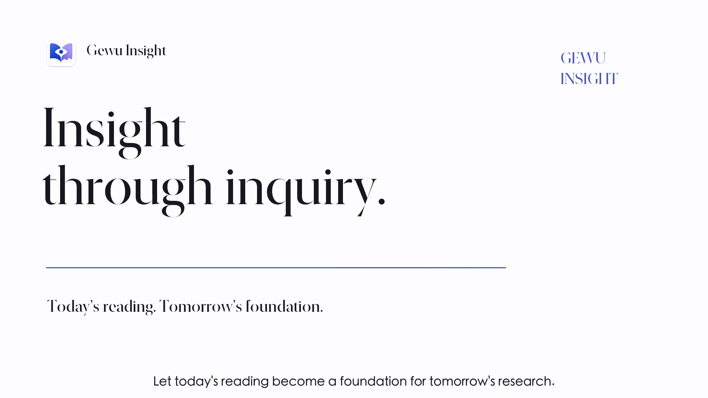

# Gewu Insight

**文献探索、読解、研究プロジェクトの整理、AI との協働をつなぐ統合研究ワークスペース。**

Gewu Insight は、学術論文の発見・整理・読解を一つにまとめた研究者向けデスクトップアプリです。プレプリント、出版版、補足資料、読書ノートを同じ論文に紐づけ、複数の研究プロジェクトから参照できます。必要に応じて AI アシスタントを接続し、許可した資料と保存済みの分析を読み返して研究を続けられます。

[English](../../README.md) · [简体中文](README.zh-CN.md) · [繁體中文](README.zh-TW.md) · **日本語** · [한국어](README.ko.md) · [Français](README.fr.md) · [Deutsch](README.de.md)

[**macOS 版を入手**](https://github.com/LKong92/Gewu-Insight/releases/tag/macos-1.1.0) · [**Windows 版を入手**](https://github.com/LKong92/Gewu-Insight/releases/tag/windows-1.1.0) · [**製品紹介動画**](https://gewu-insight.com/product.html?lang=en#tour) · [公式サイト](https://gewu-insight.com) · [ガイド](https://gewu-insight.com/resources.html#resources)

**macOS 1.1.0 · Windows 1.1.0**。このページは日本語の紹介です。アプリの画面と詳細マニュアルは現在英語です。操作名は画面と同じ英語表記にしています。

## 動画で見る Gewu Insight

**[▶ YouTube で概要を見る（英語・1:18）](https://www.youtube.com/watch?v=8-dK6H2t2gQ)** · [Bilibili の動画（中国語）](https://www.bilibili.com/video/BV1tRxt68E7p/) · [知乎の紹介記事（中国語）](https://zhuanlan.zhihu.com/p/2100363950269506568)

文献探索、読解、研究プロジェクトの整理、AI との協働、Zotero 連携を、一つのワークスペースでつなぐ流れを紹介します。

### 公式サイトの詳しい操作ガイド動画

<!-- Original video cover: https://gewu-insight.com/assets/product-poster-en.jpg -->

  

**[▶ 英語版を見る · 5:19](https://gewu-insight.com/product.html?lang=en#tour)** · **[▶ 中国語版を見る · 5:23](https://gewu-insight.com/product.html?lang=zh#tour)**

表紙をクリックすると公式サイトで再生できます。動画は英語・中国語で、章ごとに文献探索、ライブラリ、読書、研究業績、AI 連携を確認できます。

## できること

- **文献を追う**：Journal、Subject、Author Monitor で、雑誌・研究テーマ・著者を継続的に確認。
- **資料をまとめる**：Paper Files に各版、補足資料、注釈、ノートを紐づけ、Default ファイルを選択。
- **研究ごとに整理する**：Library と Spaces で、同じ論文の記録を複数のプロジェクトから利用。
- **AI と読み進める**：許可した原文と保存済み分析を読み、新しい分析を同じ論文に追加。
- **自分の業績を管理する**：My Publications で発表論文、著者の役割、引用情報、エクスポートを管理。

実際のアプリ画面を見る

[5 分 19 秒の紹介動画](https://gewu-insight.com/product.html?lang=en#tour)で、実際の研究ワークフローをご覧いただけます。

## インストールと更新

| OS | 必要環境 | ダウンロード |
| --- | --- | --- |
| macOS | macOS 14 以降、Apple silicon または Intel | [1.1.0 DMG](https://github.com/LKong92/Gewu-Insight/releases/tag/macos-1.1.0) |
| Windows | Windows 10 1607（14393）以降、または Windows 11。Intel/AMD x64 | [1.1.0 Setup](https://github.com/LKong92/Gewu-Insight/releases/tag/windows-1.1.0) |

Release の **Assets** からインストーラーを選んでください。Source code ZIP はアプリのインストーラーではありません。Mac では DMG 内の App を Applications に移動し、Windows では Setup を実行してスタートメニューから起動します。

**Gewu Database** を新規作成するか、既存のものを開きます。プログラムとは別のフォルダーに置いてください。Windows で既存の文献を引き継ぐ場合は **Use existing Gewu Database** を選びます。Python などは同梱されています。WebView2 の導入には通信が必要な場合があります。Mac 版は Apple の公証を受けておらず、Windows インストーラーは未署名です。[初回起動の説明](https://gewu-insight.com/download.html)をご確認ください。任意の LibreOffice と TeX は別途導入します。

Mac 1.0.x／Windows 1.0.0 からは、元のデータベースを保持して一度手動で 1.1.0 に更新します。以後は Mac の **Gewu Insight → Check for Updates**、Windows の **Help → Check for Updates** を使えます。更新前にバックアップし、Zotero の Gewu タブを閉じ、インポートを完了または一時停止してください。

## まず論文を一つ試す

手元の PDF を Library にドラッグするか、Browser で[本プロジェクトの論文](https://arxiv.org/abs/2610.14538)を開いて **Save to Gewu** を選びます。PDF が取得できない場合は arXiv からダウンロードし、同じ記録の Paper Files に追加してください。

1. 研究用フォルダーに保存し、**Paper Details** と PDF を確認します。
2. AI を使う場合は[接続ガイド](../AI_ACCESS.md)に従って **AI Access** を設定し、必要なコレクションと読み取り・分析保存権限を指定します。
3. **Gewu Key** を実際の値に置き換えて、接続済みクライアントに依頼します。

   > Gewu MCP で YOUR_GEWU_KEY の論文と許可された PDF を読み、問い、根拠、限界をページ番号付きで整理してください。save_analysis で同じ論文に保存し、元ファイルの ID と SHA-256 を保持してください。既存ファイルは上書きしないでください。

4. 次のセッションでは、同じ権限を持つクライアントに原文と保存済み分析を読んでもらい、未解決の問いから再開します。保存結果は Paper Files で確認できます。

引き継ぐのは保存した資料と分析です。**AI の会話履歴を自動同期する機能ではありません。** AI アカウントなしでも文献の発見・整理・読解を利用できます。

## Zotero との連携

単体 App の **Plugin → Zotero Integration** から同梱プラグインを導入すると、Zotero タブから同じ Gewu と選択済みデータベースを利用できます。

**Save to Gewu** は Gewu に保存し、**Save to Zotero** はメタデータと、選択した場合は取得済み Default PDF をコピーします。**Loader → Import from Zotero** はプレビュー後にコレクション階層（空のコレクションを含む）をコピーし、Gewu のローカル保存規則に従って配置します。Zotero の元データとファイルは保持されます。継続的な双方向同期ではありません。[手順を見る](https://gewu-insight.com/zotero.html)。

## データ・対応状況・ライセンス

データベース、PDF、添付資料はローカルに保存されます。新着文献や出版社サイト、オンライン AI には通信が必要です。AI Access は初期状態で無効です。AI クライアントは許可された内容をモデル提供元に送信する場合があります。分析は原文と照合してください。MCP の権限は、プログラムが別途持つ OS のファイルアクセス権を制限しません。

App とバックグラウンドサービスを終了してから、データベース全体、他の管理フォルダー、外部リンク先の原本をバックアップしてください。アプリのコピーだけでは研究資料を保護できません。アクセス制御や有料閲覧の制限を回避する機能はありません。

開発・検証の中心は macOS です。Windows 11 は仮想環境で限定的に検証し、Windows 10 の修正は主に外部テスターの報告に基づいています。掲載画面と論文の評価環境は macOS です。

独自の[学術・非商用研究ライセンス](../../LICENSE)によるソース公開ソフトウェアです。オープンソースライセンスではありません。条件に従った研究利用・改変・共有が可能で、商用利用には別途書面での許可が必要です。第三者の資料には各自の条件が適用されます。

[製品紹介](https://gewu-insight.com/product.html) · [両 OS のガイド](https://gewu-insight.com/resources.html#resources) · [AI 連携](https://gewu-insight.com/ai.html) · [問題を報告](https://github.com/LKong92/Gewu-Insight/issues)

中国語名は「格物洞见」。具体的な現象を探究し、物理的なイメージと直観から洞察を得る姿勢を表しています。研究上の問いと判断は研究者が担います。

引用：Kong, L. & Wu, Z. *A Stateful Research Information Infrastructure for Scientific Discovery.* arXiv:2610.14538 (2026). [論文](https://arxiv.org/abs/2610.14538) · [BibTeX・再現用資料](../../README.md#citation)。

Copyright © 2026 Lingyuan Kong and Zhengran Wu.
