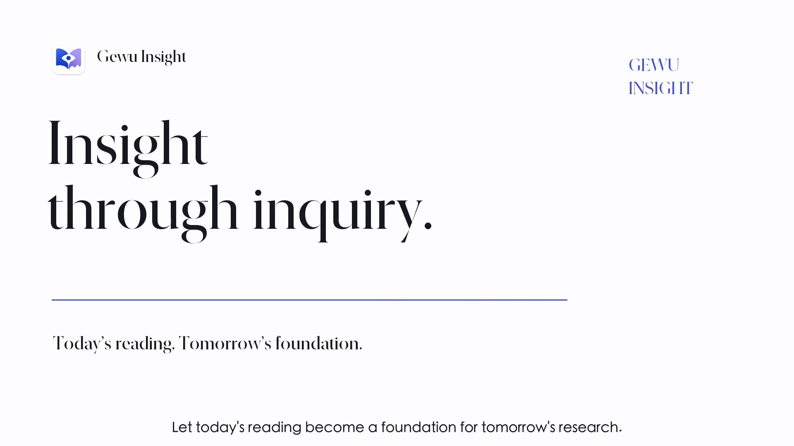

# Gewu Insight

**새 논문을 살펴보고, PDF와 노트를 정리하고, 지난번 연구에서 이어서 시작하세요.**

Gewu Insight는 연구자를 위한 데스크톱 문헌 작업 공간입니다. 논문 탐색, 정리, 읽기를 연결하고 프리프린트, 출판본, 부록, 읽기 노트를 같은 논문에 모아 둡니다. 여러 연구 프로젝트에서 같은 기록을 활용할 수 있으며, 원하면 AI 도우미가 허용된 자료와 저장된 분석을 읽고 연구를 이어가도록 연결할 수 있습니다.

[English](../../README.md) · [简体中文](README.zh-CN.md) · [繁體中文](README.zh-TW.md) · [日本語](README.ja.md) · **한국어** · [Français](README.fr.md) · [Deutsch](README.de.md)

[**macOS 다운로드**](https://github.com/LKong92/Gewu-Insight/releases/tag/macos-1.1.0) · [**Windows 다운로드**](https://github.com/LKong92/Gewu-Insight/releases/tag/windows-1.1.0) · [**제품 소개 영상**](https://gewu-insight.com/product.html?lang=en#tour) · [공식 사이트](https://gewu-insight.com) · [사용 안내서](https://gewu-insight.com/resources.html#resources)

**macOS 1.1.0 · Windows 1.1.0**. 이 페이지는 한국어 소개입니다. 앱 화면과 상세 안내서는 현재 영어이며, 메뉴 이름도 실제 화면의 영어 표기를 사용합니다.

## 영상으로 살펴보기

<!-- Original video cover: https://gewu-insight.com/assets/product-poster-en.jpg -->

  

**[▶ 영어 영상 · 5:19](https://gewu-insight.com/product.html?lang=en#tour)** · **[▶ 중국어 영상 · 5:23](https://gewu-insight.com/product.html?lang=zh#tour)**

표지를 클릭하면 공식 사이트에서 재생됩니다. 영상은 영어와 중국어로 제공되며, 챕터별로 문헌 탐색, 라이브러리, 읽기, 연구 실적, AI 연동을 볼 수 있습니다.

## 주요 기능

- **문헌 추적:** Journal, Subject, Author Monitor로 학술지, 연구 주제, 저자의 새 연구를 확인합니다.
- **자료 관리:** Paper Files에 여러 버전, 부록, 주석과 노트를 연결하고 Default 파일을 선택합니다.
- **프로젝트별 정리:** Library와 Spaces에서 같은 논문 기록을 여러 연구 맥락에 활용합니다.
- **AI와 이어 읽기:** 권한을 부여한 클라이언트가 원문과 이전 분석을 읽고 새로운 분석을 같은 논문에 저장합니다.
- **연구 실적 정리:** My Publications에서 발표 논문, 저자 역할, 인용 정보 및 내보내기를 관리합니다.

실제 앱 화면 보기

[5분 19초 소개 영상](https://gewu-insight.com/product.html?lang=en#tour)에서 실제 연구 흐름을 볼 수 있습니다.

## 설치와 업데이트

| 플랫폼 | 요구 사항 | 다운로드 |
| --- | --- | --- |
| macOS | macOS 14 이상, Apple silicon 또는 Intel | [1.1.0 DMG](https://github.com/LKong92/Gewu-Insight/releases/tag/macos-1.1.0) |
| Windows | Windows 10 1607(14393) 이상 또는 Windows 11, Intel/AMD x64 | [1.1.0 Setup](https://github.com/LKong92/Gewu-Insight/releases/tag/windows-1.1.0) |

Release의 **Assets**에서 설치 파일을 받으세요. Source code ZIP은 앱 설치 파일이 아닙니다. Mac에서는 DMG 안의 App을 Applications로 옮기고, Windows에서는 Setup을 실행한 뒤 시작 메뉴에서 엽니다.

**Gewu Database**를 새로 만들거나 기존 것을 선택하고 프로그램과 별도로 보관합니다. Windows에서 기존 자료를 유지하려면 **Use existing Gewu Database**를 선택하세요. Python 등은 포함되어 있습니다. WebView2 설치에는 인터넷이 필요할 수 있습니다. Mac 패키지는 Apple 공증을 받지 않았고 Windows 설치 파일은 서명되지 않았습니다. [설치 안내](https://gewu-insight.com/download.html)를 확인하세요. 선택 기능인 LibreOffice와 TeX는 별도 설치합니다.

Mac 1.0.x와 Windows 1.0.0은 기존 데이터베이스를 유지하면서 한 번 수동으로 1.1.0을 설치해야 합니다. 이후 Mac에서는 **Gewu Insight → Check for Updates**, Windows에서는 **Help → Check for Updates**를 사용합니다. 업데이트 전에 백업하고 Zotero의 Gewu 탭을 닫은 뒤 가져오기를 완료하거나 일시 정지하세요.

## 논문 한 편으로 시작하기

기존 PDF를 Library에 끌어 놓거나 Browser에서 [프로젝트 논문](https://arxiv.org/abs/2610.14538)을 열어 **Save to Gewu**를 선택하세요. PDF가 확보되지 않았다면 arXiv에서 내려받아 같은 기록의 Paper Files에 첨부할 수 있습니다.

1. 연구 폴더에 보관하고 **Paper Details**와 PDF를 확인합니다.
2. AI를 쓰려면 [연결 안내](../AI_ACCESS.md)에 따라 **AI Access**에서 컬렉션과 필요한 읽기·분석 저장 권한을 지정합니다.
3. 실제 **Gewu Key**를 넣어 연결된 클라이언트에 요청합니다.

   > Gewu MCP로 YOUR_GEWU_KEY 논문과 허용된 PDF를 읽어 주세요. 연구 질문, 근거, 한계를 페이지 번호와 함께 정리하고 save_analysis로 같은 논문에 저장하세요. 원본 파일 ID와 SHA-256을 유지하고 기존 파일은 덮어쓰지 마세요.

4. 다음 세션에서 같은 권한을 가진 클라이언트에 원문과 저장된 분석을 먼저 읽게 한 뒤 남은 질문을 논의합니다. 저장 결과는 Paper Files에서 확인합니다.

이어지는 것은 저장된 자료와 분석입니다. **AI 대화 전체를 자동으로 동기화하지 않습니다.** AI 계정 없이도 문헌 탐색, 관리, 읽기를 사용할 수 있습니다.

## Zotero와 함께 사용하기

독립 App의 **Plugin → Zotero Integration**에서 포함된 플러그인을 설치합니다. Zotero 탭은 같은 Gewu 설치와 선택된 데이터베이스를 사용하므로 문헌과 설정을 공유합니다.

**Save to Gewu**는 Gewu에 저장하고, **Save to Zotero**는 메타데이터와 선택 시 기존 Default PDF를 복사합니다. **Loader → Import from Zotero**는 미리 보기 후 빈 컬렉션을 포함한 계층 구조를 복사하고 Gewu의 로컬 파일 규칙에 맞춰 저장합니다. Zotero의 원래 데이터와 파일은 유지됩니다. 지속적인 양방향 동기화 기능은 아닙니다. [그림과 함께 보는 방법](https://gewu-insight.com/zotero.html).

## 데이터, 지원 범위, 라이선스

데이터베이스, PDF, 첨부 파일은 로컬에 있습니다. 새 논문 탐색, 출판사 사이트, 온라인 AI는 네트워크를 사용합니다. AI Access는 기본적으로 꺼져 있으며 클라이언트가 허용된 내용을 모델 제공자에게 전송할 수 있습니다. 분석을 원문과 확인하세요. MCP 권한은 프로그램이 별도로 가진 운영체제 파일 접근 권한을 제한하지 않습니다.

App과 백그라운드 서비스를 종료한 뒤 전체 데이터베이스, 다른 관리 폴더와 외부 연결 원본도 백업하세요. 프로그램만 복사하면 연구 자료는 백업되지 않습니다. 유료 접근 제한이나 접근 제어를 우회하지 않습니다.

주 개발·테스트 환경은 macOS입니다. Windows 11은 가상 머신에서 제한적으로 검사했고, Windows 10 수정은 주로 외부 테스터의 피드백을 따랐습니다. 이 페이지의 화면과 논문 평가 환경은 macOS입니다.

별도의 [학술·비상업 연구 라이선스](../../LICENSE)를 사용하는 소스 공개 소프트웨어이며 오픈소스 라이선스는 아닙니다. 조건에 따라 연구, 수정, 공유가 가능하고 상업적 이용에는 별도의 서면 허가가 필요합니다. 제3자 자료에는 각자의 조건이 적용됩니다.

[제품 소개](https://gewu-insight.com/product.html) · [플랫폼별 안내서](https://gewu-insight.com/resources.html#resources) · [AI 연결](https://gewu-insight.com/ai.html) · [문제 제보](https://github.com/LKong92/Gewu-Insight/issues)

중국어 이름은 ‘格物洞见’입니다. 구체적인 현상을 탐구하고 물리적 그림과 직관에서 통찰을 얻는다는 뜻을 담고 있습니다. 연구 질문과 과학적 판단은 연구자가 맡습니다.

인용: Kong, L. & Wu, Z. *A Stateful Research Information Infrastructure for Scientific Discovery.* arXiv:2610.14538 (2026). [논문](https://arxiv.org/abs/2610.14538) · [BibTeX 및 재현 자료](../../README.md#citation).

Copyright © 2026 Lingyuan Kong and Zhengran Wu.
