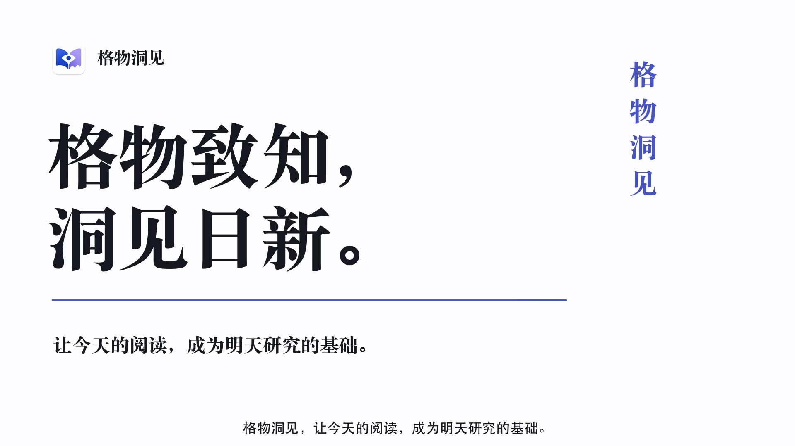

# Gewu Insight · 格物洞见

**追踪新论文，整理 PDF 与笔记，让下一次研究接着上一次继续。**

格物洞见是面向研究者的桌面文献工作空间，把论文发现、整理、阅读和积累放在一起。同一篇论文的预印本、正式版本、附件和阅读笔记保持关联，也可以在多个研究项目中使用。你还可以连接 AI 助手，让它读取你授权的资料和已保存分析，继续研究。

[English](../../README.md) · **简体中文** · [繁體中文](README.zh-TW.md) · [日本語](README.ja.md) · [한국어](README.ko.md) · [Français](README.fr.md) · [Deutsch](README.de.md)

[**下载 Mac 版**](https://github.com/LKong92/Gewu-Insight/releases/tag/macos-1.1.0) · [**下载 Windows 版**](https://github.com/LKong92/Gewu-Insight/releases/tag/windows-1.1.0) · [**观看产品演示**](https://gewu-insight.com/product.html?lang=zh#tour) · [官网](https://gewu-insight.com) · [使用手册](https://gewu-insight.com/resources.html#resources)

**macOS 1.1.0 · Windows 1.1.0**。本页提供中文介绍；软件界面和详细手册目前为英文，菜单名称保留英文以便查找。

## 观看操作演示

<!-- Original video cover: https://gewu-insight.com/assets/product-poster-zh.jpg -->

  

**[▶ 中文演示 · 5:23](https://gewu-insight.com/product.html?lang=zh#tour)** · **[▶ English · 5:19](https://gewu-insight.com/product.html?lang=en#tour)**

点击封面在官网播放，可按章节跳转查看发现文献、文献库、阅读、个人成果和 AI 协作。

## 它能帮你做什么

- **持续发现文献**：通过 Journal、Subject、Author 三类 Monitor 跟进期刊、研究主题与作者。
- **管理论文与文件**：把不同版本、补充材料、批注和笔记放在同一篇论文的 Paper Files 中，并选择默认阅读文件。
- **围绕课题组织**：通过 Library 和 Spaces 整理文献，同一篇论文在不同项目中沿用同一个记录。
- **接续 AI 阅读**：让获授权的 AI 客户端读取原文与已保存分析，把新的分析保存回同一篇论文。
- **整理个人成果**：在 My Publications 中维护发表记录、作者角色和引用信息，并导出成果列表。

查看实际软件截图

官网的[产品演示](https://gewu-insight.com/product.html?lang=zh#tour)长 5 分 23 秒，介绍发现、阅读、文献库、个人成果和 AI 协作。

## 安装与更新

| 平台 | 要求 | 下载 |
| --- | --- | --- |
| macOS | macOS 14+；Apple silicon 或 Intel | [1.1.0 DMG](https://github.com/LKong92/Gewu-Insight/releases/tag/macos-1.1.0) |
| Windows | Windows 10 1607+（14393+）或 Windows 11；Intel/AMD x64 | [1.1.0 Setup](https://github.com/LKong92/Gewu-Insight/releases/tag/windows-1.1.0) |

1. 在 Release 的 **Assets** 中下载安装包，不要把 Source code ZIP 当安装包。Mac 打开 DMG 后将 App 拖入 Applications；Windows 运行 Setup，再从开始菜单打开。
2. 新建或打开 **Gewu Database**，与程序分开存放。保留已有库时，Windows 选择 **Use existing Gewu Database**。
3. 将一篇 PDF 拖入 Library 文件夹，或在 Browser 打开论文页面并选择 **Save to Gewu**，检查导入信息。

Python 等依赖已打包。Windows 若需安装 WebView2，需要联网。Mac 包未经 Apple 公证，Windows 安装包未签名；首次启动请参考[安装说明](https://gewu-insight.com/download.html)。可选 LibreOffice、TeX 另行安装。

Mac 1.0.x、Windows 1.0.0 用户需手动升级到 1.1.0 一次，并保留原数据库。之后分别从 **Gewu Insight → Check for Updates**（Mac）或 **Help → Check for Updates**（Windows）检查更新。安装前备份数据、关闭 Zotero 的格物标签页，并完成或暂停导入。

## 用一篇论文体验完整流程

用你已有的 PDF，或在 Browser 打开[格物项目论文](https://arxiv.org/abs/2610.14538)，通过 **Save to Gewu** 保存。若没有取得 PDF，可从 arXiv 下载后附加到同一记录的 Paper Files。

1. 将论文放入当前课题的文件夹，检查 **Paper Details** 并阅读 PDF。
2. 如需 AI，按[连接指南](../AI_ACCESS.md)配置 **AI Access**，仅授权这个集合，并允许所需的元数据、文件、已保存分析读取和分析写入。
3. 将 Paper Details 中的真实 **Gewu Key** 填入以下提示，交给已连接的客户端：

   > 使用格物 MCP 读取论文 YOUR_GEWU_KEY 及其授权 PDF。概括研究问题、证据和局限，标明页码。通过 save_analysis 保存到同一篇论文，保留源文件 ID 和 SHA-256，不覆盖已有文件。

4. 下次打开有相同访问权限的客户端，请它先读取该论文原文和已有分析，再继续讨论未解决的问题。保存结果可在 Paper Files 中查看。

接续的是保存下来的资料与分析，**不是自动同步所有聊天记录**。不连接 AI，也能使用文献发现、管理和阅读功能。

## 已经在用 Zotero？

在独立格物的 **Plugin → Zotero Integration** 安装随软件附带的插件。Zotero 中显示的是同一个格物安装和数据库，文献与设置共享。

- **Save to Gewu**：保存在格物的 Library 或 Space。
- **Save to Zotero**：复制元数据，并可选复制已有的 Default PDF。
- **Loader → Import from Zotero**：先预览，再复制集合及层级，包含空集合，并按格物的本地文件规则存放。Zotero 原库和原文件保留。

这些是明确发起的复制操作，不是两套文献库持续双向同步。[查看图文操作步骤](https://gewu-insight.com/zotero.html)。

## 数据、平台和许可

数据库、PDF 和附件保存在本机；发现新论文、访问出版社及在线 AI 服务需要网络。AI Access 默认关闭，客户端可能将获授权内容发送给其模型服务商，分析结果需要核对。MCP 权限不会限制程序独立的操作系统文件权限。

备份时退出 App 和后台服务，备份完整 Gewu Database、其他受管理目录和外部链接原件；只备份程序不等于备份研究资料。格物不绕过付费墙或访问控制。

macOS 是主要开发测试平台；Windows 11 仅做过有限虚拟机测试，Windows 10 修正主要依据外部测试者反馈。这里的截图来自 macOS。论文中的评估也在 macOS 上完成。

项目采用自定义[学术与非商业研究许可证](../../LICENSE)，属于源码可用软件，并非开源许可证。允许在许可条件下进行非商业学术研究、修改和分享；商业使用须另行取得书面授权。第三方内容仍遵守各自条款。

## 继续了解

[官网产品介绍](https://gewu-insight.com/product.html) · [两平台手册](https://gewu-insight.com/resources.html#resources) · [AI 操作说明](https://gewu-insight.com/ai.html) · [提交反馈](https://github.com/LKong92/Gewu-Insight/issues)

“格物洞见”取意于格物致知：从实验现象中格物，以物理图像和直觉求洞见。软件保留研究上下文，问题、解释和科学判断仍由研究者主导。

引用：Kong, L. & Wu, Z. *A Stateful Research Information Infrastructure for Scientific Discovery.* arXiv:2610.14538 (2026)。[论文](https://arxiv.org/abs/2610.14538) · [BibTeX 与复现材料](../../README.md#citation)。

Copyright © 2026 Lingyuan Kong and Zhengran Wu.
