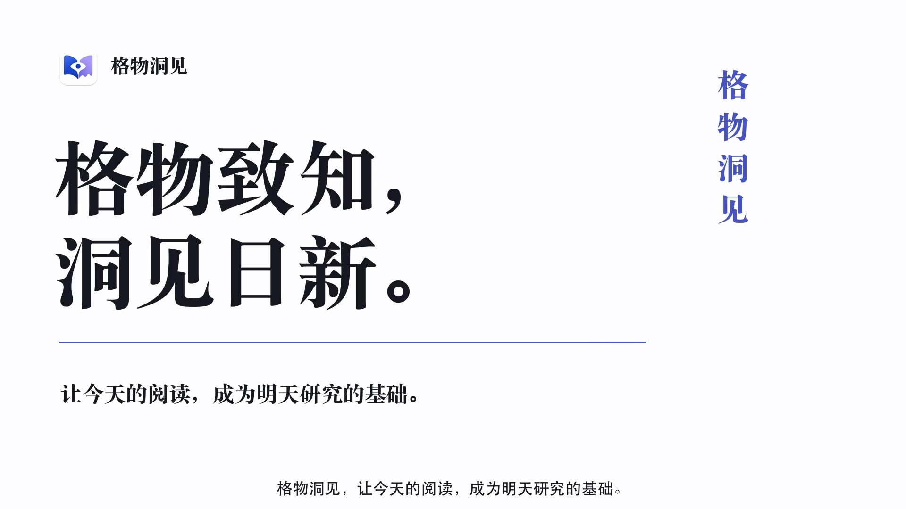

# Gewu Insight · 格物洞見

**追蹤新論文，整理 PDF 與筆記，讓下一次研究接續上一次的進展。**

格物洞見是研究者的桌面文獻工作空間，整合論文探索、整理與閱讀。同一篇論文的預印本、正式版本、附件和筆記保持關聯，也能用於不同研究專案。你可以選擇連接 AI 助手，讓它讀取已授權的資料與儲存的分析，再繼續研究。

[English](../../README.md) · [简体中文](README.zh-CN.md) · **繁體中文** · [日本語](README.ja.md) · [한국어](README.ko.md) · [Français](README.fr.md) · [Deutsch](README.de.md)

[**下載 Mac 版**](https://github.com/LKong92/Gewu-Insight/releases/tag/macos-1.1.0) · [**下載 Windows 版**](https://github.com/LKong92/Gewu-Insight/releases/tag/windows-1.1.0) · [**觀看產品示範**](https://gewu-insight.com/product.html?lang=zh#tour) · [官網](https://gewu-insight.com) · [使用手冊](https://gewu-insight.com/resources.html#resources)

**macOS 1.1.0 · Windows 1.1.0**。本頁為繁體中文介紹；軟體介面與詳細手冊目前使用英文，操作名稱保留英文。

## 觀看操作示範

<!-- Original video cover: https://gewu-insight.com/assets/product-poster-zh.jpg -->

  

**[▶ 中文示範 · 5:23](https://gewu-insight.com/product.html?lang=zh#tour)** · **[▶ English · 5:19](https://gewu-insight.com/product.html?lang=en#tour)**

點擊封面即可在官網播放，並可依章節查看文獻探索、文獻庫、閱讀、個人成果與 AI 協作。

## 可以如何使用

- **跟進文獻**：以 Journal、Subject、Author 三種 Monitor 追蹤期刊、主題與作者。
- **保留研究材料**：在 Paper Files 集中管理版本、補充資料、註記和筆記，並選擇預設閱讀檔案。
- **組織研究專案**：使用 Library 與 Spaces，同一篇論文在不同專案中仍共用一筆記錄。
- **接續 AI 閱讀**：讓已授權的客戶端讀取原文及既有分析，並將新分析存回該論文。
- **整理個人成果**：以 My Publications 管理發表紀錄、作者角色、引用資訊及匯出。

查看實際軟體畫面

官網的[產品影片](https://gewu-insight.com/product.html?lang=zh#tour)長 5 分 23 秒，展示這些日常研究流程。

## 安裝與更新

| 平台 | 需求 | 下載 |
| --- | --- | --- |
| macOS | macOS 14+；Apple silicon 或 Intel | [1.1.0 DMG](https://github.com/LKong92/Gewu-Insight/releases/tag/macos-1.1.0) |
| Windows | Windows 10 1607+（14393+）或 Windows 11；Intel/AMD x64 | [1.1.0 Setup](https://github.com/LKong92/Gewu-Insight/releases/tag/windows-1.1.0) |

從 Release 的 **Assets** 下載安裝檔，不要使用 Source code ZIP 作為安裝程式。Mac 將 DMG 裡的 App 拖入 Applications；Windows 執行 Setup 後，從開始功能表啟動。

建立或開啟 **Gewu Database**，與程式分開儲存。Windows 要保留既有資料時，選擇 **Use existing Gewu Database**。Python 等相依套件已隨附；Windows 安裝 WebView2 時可能需要網路。Mac 套件未經 Apple 公證，Windows 安裝程式未簽署，詳見[安裝說明](https://gewu-insight.com/download.html)。選用的 LibreOffice 與 TeX 需另行安裝。

Mac 1.0.x 與 Windows 1.0.0 需手動升級至 1.1.0 一次並保留原資料庫。之後使用 **Gewu Insight → Check for Updates**（Mac）或 **Help → Check for Updates**（Windows）。安裝前請備份、關閉 Zotero 的格物分頁，並完成或暫停匯入。

## 從一篇論文開始

將已有的 PDF 拖入 Library，或在 Browser 開啟[本專案論文](https://arxiv.org/abs/2610.14538)並按 **Save to Gewu**。若未取得 PDF，可從 arXiv 下載，再附加到同一記錄的 Paper Files。

1. 放入課題資料夾，檢查 **Paper Details**，閱讀 PDF。
2. 若要使用 AI，依[連接說明](../AI_ACCESS.md)設定 **AI Access**，選擇集合及必要的讀取、分析儲存權限。
3. 將真實的 **Gewu Key** 填入以下提示，交給已連接的客戶端：

   > 使用格物 MCP 讀取論文 YOUR_GEWU_KEY 與獲授權的 PDF。概述問題、證據和限制，附上頁碼。以 save_analysis 儲存到同一論文，保留來源檔案 ID 與 SHA-256，不覆寫既有檔案。

4. 下次請有權限的客戶端先閱讀原文與已儲存分析，再討論未解問題。筆記可在 Paper Files 查看。

保留的是資料與分析，**不會自動同步所有 AI 對話**。不用 AI 帳號也能探索、管理與閱讀文獻。

## 與 Zotero 一起使用

在獨立 App 的 **Plugin → Zotero Integration** 安裝隨附插件。Zotero 分頁連接同一套格物與選定資料庫，共用文獻和設定。

**Save to Gewu** 存入格物；**Save to Zotero** 複製中繼資料，並可選擇複製現有 Default PDF。**Loader → Import from Zotero** 可先預覽，再複製集合階層（含空集合），按格物的本機檔案規則存放。Zotero 原資料與原檔保留。這些操作並非持續雙向同步。[圖文步驟](https://gewu-insight.com/zotero.html)。

## 資料、支援與授權

資料庫、PDF 和附件保存在本機。探索新文獻、出版社網站和線上 AI 需要網路。AI Access 預設關閉；客戶端可能將授權內容傳送至其模型服務商，請核對分析。MCP 授權不限制程式另外取得的作業系統檔案權限。

退出 App 與背景服務後，備份完整資料庫、其他受管理目錄及外部連結原檔；僅備份程式無法保護研究資料。格物不繞過付費牆或存取控制。

macOS 為主要開發測試平台。Windows 11 僅經有限虛擬機測試；Windows 10 修正主要依外部測試者回饋。截圖和研究論文中的評估來自 macOS。

採用自訂[學術與非商業研究授權](../../LICENSE)，屬於原始碼可用軟體，並非開放原始碼授權。依條件允許非商業研究、修改及分享；商業使用需另行取得書面授權。第三方內容適用各自條款。

[官網產品介紹](https://gewu-insight.com/product.html) · [兩平台手冊](https://gewu-insight.com/resources.html#resources) · [AI 說明](https://gewu-insight.com/ai.html) · [回報問題](https://github.com/LKong92/Gewu-Insight/issues)

「格物洞見」取意於格物致知：從實驗現象中格物，以物理圖像和直覺求洞見。研究問題與科學判斷仍由研究者主導。

引用：Kong, L. & Wu, Z. *A Stateful Research Information Infrastructure for Scientific Discovery.* arXiv:2610.14538 (2026)。[論文](https://arxiv.org/abs/2610.14538) · [BibTeX 與重現資料](../../README.md#citation)。

Copyright © 2026 Lingyuan Kong and Zhengran Wu.
